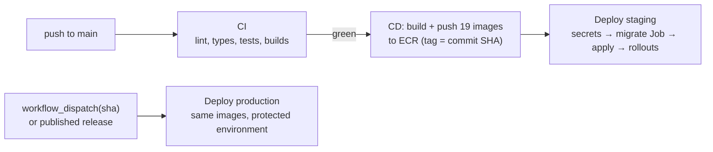

# Deployment

FoodGrid runs on AWS: one EKS cluster per environment (staging, production) in
`ap-south-1`, RDS PostgreSQL, ElastiCache, S3 + CloudFront for media, and an ALB in
front of the web apps and the API gateway. Terraform creates the infrastructure;
GitHub Actions builds the images and deploys the Kubernetes manifests.



## 1. Infrastructure (once per account and environment)

The details, including every command, are in
[infrastructure/terraform/README.md](../infrastructure/terraform/README.md). In short:

| Order | Stack             | Creates                                                                             |
| ----- | ----------------- | ----------------------------------------------------------------------------------- |
| 1     | `bootstrap`       | the S3 bucket that holds the other stacks' state                                    |
| 2     | `global`          | 19 ECR repositories, the GitHub OIDC provider, the CI push role                     |
| 3     | `envs/staging`    | VPC, EKS and add-ons, RDS, ElastiCache, S3/CloudFront, certificates, secrets, roles |
| 4     | `envs/production` | the same, sized for production, plus WAF                                            |

After the environment stacks:

1. **Fill the secrets.** Terraform creates `foodgrid/<env>/app`, `foodgrid/<env>/auth`
   and `foodgrid/<env>/payment` in Secrets Manager with every key the services need.
   It writes the values it owns (`DATABASE_URL`, `REDIS_URL`); add the JWT key pair,
   Razorpay keys, Google client ids and provider credentials yourself. External Secrets
   syncs them into the cluster.
2. **Create the application database role** with the SQL in the Terraform README
   (Terraform cannot reach the private database).
3. **Point DNS** for the ingress hosts at the ALB (or let Terraform create the records
   with `create_alb_dns_records = true` once the ALB exists).

## 2. GitHub setup

Copy the `github_variables` outputs into GitHub (the Terraform README has a
`gh variable set` loop):

| Scope                    | Variables                                                                                                                                     |
| ------------------------ | --------------------------------------------------------------------------------------------------------------------------------------------- |
| Repository               | `AWS_REGION`, `AWS_ACCOUNT_ID`, `ECR_REGISTRY`, `AWS_CI_ROLE_ARN`, `AWS_TERRAFORM_PLAN_ROLE_ARN` (optional), `TF_STATE_BUCKET` (for PR plans) |
| Environment `staging`    | `EKS_CLUSTER_NAME`, `AWS_DEPLOY_ROLE_ARN`, `ACM_CERTIFICATE_ID`                                                                               |
| Environment `production` | the same plus `WAF_WEB_ACL_ID`                                                                                                                |

Add required reviewers to the `production` environment. No long-lived AWS keys are
stored in GitHub: every job assumes a role through OIDC, and the roles only trust this
repository (the CI role only `main` and `v*` tags).

## 3. What CI and CD do

| Workflow        | Trigger                                                | Does                                                                                                       |
| --------------- | ------------------------------------------------------ | ---------------------------------------------------------------------------------------------------------- |
| `ci.yml`        | pull requests, pushes to `main`                        | format, lint, typecheck, unit tests, integration tests against Postgres + Redis, full build, Docker builds |
| `cd.yml`        | CI succeeded on `main`; manual; releases               | builds and pushes the images, then calls `deploy.yml`                                                      |
| `deploy.yml`    | called by CD                                           | renders the overlay, applies secrets, runs the migration Job, applies, waits for rollouts                  |
| `flutter.yml`   | changes under `packages/flutter_core`, `apps/*-mobile` | analyze and test the core and the three apps                                                               |
| `terraform.yml` | changes under `infrastructure/terraform`               | fmt and validate; plans on PRs when the plan role is set                                                   |

A deploy, step by step (`deploy.yml`):

1. Check every `foodgrid/<name>:<sha>` image exists in ECR.
2. Render the overlay with `.github/scripts/render-overlay.sh`: fill `ACCOUNT_ID`, the
   certificate id and the WAF id from the environment variables, pin every image to the
   commit, and fail if a placeholder or an unpinned image is left.
3. Apply the namespace and ExternalSecrets, and wait for the secrets to sync.
4. Delete the previous `db-migrate` Job, apply the new one and wait for it; on failure
   print its logs and stop. Migrations always run before new code. They also insert the
   reference data every environment needs (the marketplace categories); the demo seed is
   never needed in production. Admins manage categories in admin-web under Content →
   Marketplace categories.
5. Apply the whole overlay and wait for every Deployment to roll out.

Production promotes an image that already passed staging: run CD with
`workflow_dispatch` and the commit SHA, or publish a release. Nothing is rebuilt.

## Kubernetes layout

| Path                                       | What                                                                                                                                                                                                  |
| ------------------------------------------ | ----------------------------------------------------------------------------------------------------------------------------------------------------------------------------------------------------- |
| `infrastructure/kubernetes/base`           | generated by `pnpm k8s:generate` (`scripts/generate-k8s.ts`): Deployments, Services, HPAs, PDBs, NetworkPolicies, the nginx gateway, ingresses, ExternalSecrets, the migrate Job. Do not edit by hand |
| `infrastructure/kubernetes/overlays/<env>` | per-environment replicas, hosts, IRSA annotation, certificate and WAF, secret paths                                                                                                                   |
| `infrastructure/monitoring`                | ServiceMonitor, PrometheusRules (alerts link to the [runbooks](./runbooks.md)) and the Grafana dashboard                                                                                              |

Render an overlay locally with `kubectl kustomize infrastructure/kubernetes/overlays/staging`
(placeholders stay as they are), or exactly as CD does with the render script and the
variables from the table above.

## Rollback

Deploy the previous good SHA again: `gh workflow run cd.yml --ref main -f sha=<sha>` for
production (approve the environment), or re-run that commit's CD run for staging. Tags
are immutable and ECR keeps the last 300 builds of each image, so nothing is rebuilt.
Migrations only go forward, so each one must stay compatible with the release before
it. The [runbook](./runbooks.md#rolling-back-a-deploy) has the full procedure.

## Vercel (web apps) + Railway (API) — alternative to AWS

The six web apps run on Vercel; the twelve API services, the gateway, PostgreSQL and Redis
run on Railway, because the services are long-running processes (event consumers, the
outbox relay, scheduled jobs, the tracking socket) that serverless functions cannot hold.
`apps/*/vercel.json`, the root `vercel.json` and `infrastructure/railway/*` are generated by
`pnpm gateway:routes` (`scripts/generate-gateway-routes.ts`); change the generator, not the
files.

### 1. Railway: the API

1. Create a project and add **PostgreSQL** and **Redis** (+ New → Database).
2. Add one service per API service and one for the gateway: + New → GitHub Repo → this
   repository and branch. Name each service exactly like its config file (`auth-service`,
   `user-service`, … `ai-service`, `gateway`) — the private addresses below use those names.
   In each service's Settings → **Config-as-code**, set the path to
   `infrastructure/railway/<name>.json`. Leave the root directory empty (the repository root).
3. **Shared variables** (Project Settings → Shared Variables → Raw Editor):

   ```env
   DATABASE_URL=${{Postgres.DATABASE_URL}}
   REDIS_URL=${{Redis.REDIS_URL}}?family=0
   JWT_PUBLIC_KEY_BASE64=    # pnpm keys:generate on your machine, then copy from .env
   INTERNAL_SERVICE_SECRET=  # any long random string
   CUSTOMER_WEB_URL=https://foodgrid.in   # your storefront: table and cart QR codes link here
   SMS_PROVIDER=msg91        # console only logs the code (see below)
   MSG91_AUTH_KEY=
   MSG91_TEMPLATE_ID=        # a flow linked to your DLT-approved login template: ##code##, ##minutes##
   PUSH_PROVIDER=fcm
   FCM_SERVICE_ACCOUNT_BASE64=    # Firebase service-account key, base64
   GOOGLE_CLIENT_IDS=        # Google web client id(s), comma separated
   RAZORPAY_KEY_ID=          # required: payment-service does not start in production without them
   RAZORPAY_KEY_SECRET=
   RAZORPAY_WEBHOOK_SECRET=  # Razorpay dashboard → Webhooks → https://<gateway-domain>/api/v1/payments/webhooks/razorpay
   PLATFORM_GSTIN=           # your GSTIN, printed on commission and delivery-fee invoices
   PLATFORM_STATE_CODE=      # its first two digits, e.g. 09 for Uttar Pradesh (default 29, Karnataka)
   S3_MEDIA_BUCKET=          # S3-compatible storage for uploads (e.g. Cloudflare R2)
   S3_ENDPOINT=
   S3_FORCE_PATH_STYLE=true
   AWS_REGION=auto
   AWS_ACCESS_KEY_ID=
   AWS_SECRET_ACCESS_KEY=
   CDN_BASE_URL=             # public URL of that bucket
   ```

   then paste `infrastructure/railway/service-urls.env` (the private addresses of the
   services) into the same editor. Add the optional keys from `.env.example` you use
   (OpenWeather). Do not set `NODE_ENV` here: it would make the build skip the development
   dependencies; the start commands set it.

   - **Login codes**: the services run in production mode, so a code is never returned in
     the API response (`OTP_EXPOSE_IN_RESPONSE` only works locally). With
     `SMS_PROVIDER=console` the code is only written to notification-service's log, which is
     enough to try the apps yourself but not for customers.
   - **Email** (email confirmation codes, approval decisions): `EMAIL_PROVIDER=ses`,
     `SES_FROM_ADDRESS`, `SES_REGION` (e.g. `ap-south-1`), `SES_ACCESS_KEY_ID` and
     `SES_SECRET_ACCESS_KEY` (an IAM user allowed only `ses:SendEmail`). The shared `AWS_*`
     values are the storage keys and do not work for SES.
   - **Uploads**: browsers upload photos straight to the bucket, so give it a CORS rule that
     allows `PUT` and `GET` from your web domains (`https://foodgrid.in`,
     `https://*.foodgrid.in`) with any header. In Cloudflare R2: the bucket → Settings →
     CORS policy.

4. On each **API service**, add one variable: `PORT` = its port (auth-service 4001,
   user-service 4002, order-service 4003, payment-service 4004, inventory-service 4005,
   procurement-service 4006, delivery-service 4007, supplier-service 4008,
   analytics-service 4009, ads-service 4010, notification-service 4011, ai-service 4012).
   On **auth-service only**, also add `JWT_PRIVATE_KEY_BASE64` (from the same `.env`) and
   `OTP_SECRET` (another long random string; auth-service refuses to start without it).
   They sign every session and login code, so keep them off the other services, which
   only verify tokens with the public key.
5. On the **gateway**, Settings → Networking → **Generate Domain**. That URL is the API:
   `https://<gateway-domain>/api/v1`. No API service needs a public domain.
6. Deploy. Each API service runs `prisma migrate deploy` before it starts (it is
   idempotent and takes a lock; services that time out waiting for the lock while another
   one migrates retry), so the database schema is created on the first deploy.
7. **First-time setup** (once, from your machine, against the production database): the
   first admin account and a city-wide delivery zone. Deliveries are only quoted for
   restaurants inside an active zone, and admin-web has no screen for zones yet. It never
   adds demo data and is safe to run again.

   ```sh
   DATABASE_URL='<Postgres public URL>' ADMIN_EMAIL=you@example.com ADMIN_NAME='Your Name' \
   ADMIN_PASSWORD='<12+ characters>' pnpm --filter @foodgrid/database db:setup
   ```

   The zone defaults to Prayagraj, 15 km around the city centre; `ZONE_CITY=Bengaluru` is
   the other preset. For any other city, add its centre:
   `ZONE_CITY=Lucknow ZONE_LAT=26.8467 ZONE_LNG=80.9462 ZONE_RADIUS_KM=18`; run it once per
   city. Then sign in to admin-web with that email and password.

   Demo data is for a separate test database only, never production: from your machine,
   `DATABASE_URL=<test database URL> pnpm db:seed`. It adds made-up restaurants, riders and
   orders that customers would see.

### 2. Vercel: the web apps

Each web app is its own Vercel project, so a deployment holds one app (the Hobby plan
allows 12 functions per deployment) and a push builds only the apps it changes. A project
at the repository root builds nothing: the root `vercel.json` skips it.

| Project          | Root Directory        | Domain                            |
| ---------------- | --------------------- | --------------------------------- |
| `customer-web`   | `apps/customer-web`   | `foodgrid.in`, `www.foodgrid.in`  |
| `admin-web`      | `apps/admin-web`      | `admin.foodgrid.in`               |
| `restaurant-web` | `apps/restaurant-web` | `partner.foodgrid.in`             |
| `vendor-web`     | `apps/vendor-web`     | `business.foodgrid.in` (optional) |
| `supplier-web`   | `apps/supplier-web`   | `supplier.foodgrid.in`            |
| `rider-web`      | `apps/rider-web`      | `rider.foodgrid.in`               |

restaurant-web is the Food Seller Portal (restaurants and food carts) and supplier-web the
Product Seller Portal (suppliers, wholesalers and retailers). vendor-web now only shows
links to the two portals for old `business.` bookmarks: set `FOOD_SELLER_PORTAL_URL` and
`PRODUCT_SELLER_PORTAL_URL` on its project, or delete the project if nobody uses that
address. Kubernetes sets both in `foodgrid-config` (the staging overlay points them at the
staging hosts), and docker compose at the local portal ports.

For each app:

1. Add New → Project → import this repository, name the project as in the table and set
   **Root Directory** to the app's folder. Framework, install and build commands come from
   the app's `vercel.json`; leave them on their defaults. Keep "Include files outside the
   root directory in the Build Step" on (the app builds the shared packages).
2. Environment variables: `API_URL=https://<gateway-domain>/api/v1`; on `customer-web`,
   `rider-web`, `restaurant-web` and `supplier-web` also `GOOGLE_WEB_CLIENT_ID` for
   "Continue with Google" (Google Cloud Console → APIs & Services → Credentials → OAuth
   client ID, type Web; add each app's `https://` domain under Authorized JavaScript
   origins, and the same client id to `GOOGLE_CLIENT_IDS` on Railway). Until SMS login
   codes are set up (DLT), Google is the only way new customers, riders and sellers can
   sign up. `NEXT_PUBLIC_CITY` on `customer-web` picks the city the site opens in
   (`prayagraj` by default, `bengaluru` for the demo data); it is built into the pages, so
   redeploy after changing it.
3. Deploy, then Settings → Domains → add the app's domain.
4. Settings → Build and Deployment → Root Directory: keep **Skip deployment** on, so a
   push that does not touch the app or the packages it uses does not redeploy it.

Production branch: the branch you deploy (Settings → Environments → Production).

### 3. Mobile apps

Build with `--dart-define=API_URL=https://<gateway-domain>/api/v1` (see each app's README).

### Limits of this setup

- The gateway is the Node gateway from `scripts/dev-gateway.ts`: it routes, proxies the
  tracking socket, re-resolves service addresses on every request, passes the client IP
  on in `X-Forwarded-For` and, like nginx, rate limits OTP requests and password logins
  per IP (10 a minute, bursts of 5). Its limits live in memory, so run one gateway
  replica. The client IP is the first `X-Forwarded-For` hop, which a caller can set;
  auth-service's own per-phone and per-account limits apply regardless.
- After the first deploy, make a change in admin-web and check that its entry in the
  audit log shows your own IP; if it shows a Railway or Vercel address, per-IP limits
  are shared by everyone.
- The admin console has no IP allow-list here (the production Kubernetes ingress has
  one); add one with the Vercel Firewall if you need it.
- Uploads need S3-compatible storage outside Railway.
