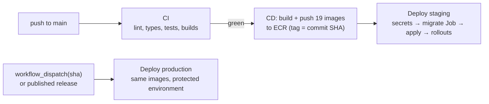

# Deployment

FoodGrid runs on AWS: one EKS cluster per environment (staging, production) in
`ap-south-1`, RDS PostgreSQL, ElastiCache, S3 + CloudFront for media, and an ALB in
front of the web apps and the API gateway. Terraform creates the infrastructure;
GitHub Actions builds the images and deploys the Kubernetes manifests.



## 1. Infrastructure (once per account and environment)

The details, including every command, are in
[infrastructure/terraform/README.md](../infrastructure/terraform/README.md). In short:

| Order | Stack             | Creates                                                                             |
| ----- | ----------------- | ----------------------------------------------------------------------------------- |
| 1     | `bootstrap`       | the S3 bucket that holds the other stacks' state                                    |
| 2     | `global`          | 19 ECR repositories, the GitHub OIDC provider, the CI push role                     |
| 3     | `envs/staging`    | VPC, EKS and add-ons, RDS, ElastiCache, S3/CloudFront, certificates, secrets, roles |
| 4     | `envs/production` | the same, sized for production, plus WAF                                            |

After the environment stacks:

1. **Fill the secrets.** Terraform creates `foodgrid/<env>/app`, `foodgrid/<env>/auth`
   and `foodgrid/<env>/payment` in Secrets Manager with every key the services need.
   It writes the values it owns (`DATABASE_URL`, `REDIS_URL`); add the JWT key pair,
   Razorpay keys, Google client ids and provider credentials yourself. External Secrets
   syncs them into the cluster.
2. **Create the application database role** with the SQL in the Terraform README
   (Terraform cannot reach the private database).
3. **Point DNS** for the ingress hosts at the ALB (or let Terraform create the records
   with `create_alb_dns_records = true` once the ALB exists).

## 2. GitHub setup

Copy the `github_variables` outputs into GitHub (the Terraform README has a
`gh variable set` loop):

| Scope                    | Variables                                                                                                                                     |
| ------------------------ | --------------------------------------------------------------------------------------------------------------------------------------------- |
| Repository               | `AWS_REGION`, `AWS_ACCOUNT_ID`, `ECR_REGISTRY`, `AWS_CI_ROLE_ARN`, `AWS_TERRAFORM_PLAN_ROLE_ARN` (optional), `TF_STATE_BUCKET` (for PR plans) |
| Environment `staging`    | `EKS_CLUSTER_NAME`, `AWS_DEPLOY_ROLE_ARN`, `ACM_CERTIFICATE_ID`                                                                               |
| Environment `production` | the same plus `WAF_WEB_ACL_ID`                                                                                                                |

Add required reviewers to the `production` environment. No long-lived AWS keys are
stored in GitHub: every job assumes a role through OIDC, and the roles only trust this
repository (the CI role only `main` and `v*` tags).

## 3. What CI and CD do

| Workflow        | Trigger                                                | Does                                                                                                       |
| --------------- | ------------------------------------------------------ | ---------------------------------------------------------------------------------------------------------- |
| `ci.yml`        | pull requests, pushes to `main`                        | format, lint, typecheck, unit tests, integration tests against Postgres + Redis, full build, Docker builds |
| `cd.yml`        | CI succeeded on `main`; manual; releases               | builds and pushes the images, then calls `deploy.yml`                                                      |
| `deploy.yml`    | called by CD                                           | renders the overlay, applies secrets, runs the migration Job, applies, waits for rollouts                  |
| `flutter.yml`   | changes under `packages/flutter_core`, `apps/*-mobile` | analyze and test the core and the three apps                                                               |
| `terraform.yml` | changes under `infrastructure/terraform`               | fmt and validate; plans on PRs when the plan role is set                                                   |

A deploy, step by step (`deploy.yml`):

1. Check every `foodgrid/<name>:<sha>` image exists in ECR.
2. Render the overlay with `.github/scripts/render-overlay.sh`: fill `ACCOUNT_ID`, the
   certificate id and the WAF id from the environment variables, pin every image to the
   commit, and fail if a placeholder or an unpinned image is left.
3. Apply the namespace and ExternalSecrets, and wait for the secrets to sync.
4. Delete the previous `db-migrate` Job, apply the new one and wait for it; on failure
   print its logs and stop. Migrations always run before new code. They also insert the
   reference data every environment needs (the marketplace categories); the demo seed is
   never needed in production. Admins manage categories in admin-web under Content →
   Marketplace categories.
5. Apply the whole overlay and wait for every Deployment to roll out.

Production promotes an image that already passed staging: run CD with
`workflow_dispatch` and the commit SHA, or publish a release. Nothing is rebuilt.

## Kubernetes layout

| Path                                       | What                                                                                                                                                                                                  |
| ------------------------------------------ | ----------------------------------------------------------------------------------------------------------------------------------------------------------------------------------------------------- |
| `infrastructure/kubernetes/base`           | generated by `pnpm k8s:generate` (`scripts/generate-k8s.ts`): Deployments, Services, HPAs, PDBs, NetworkPolicies, the nginx gateway, ingresses, ExternalSecrets, the migrate Job. Do not edit by hand |
| `infrastructure/kubernetes/overlays/<env>` | per-environment replicas, hosts, IRSA annotation, certificate and WAF, secret paths                                                                                                                   |
| `infrastructure/monitoring`                | ServiceMonitor, PrometheusRules (alerts link to the [runbooks](./runbooks.md)) and the Grafana dashboard                                                                                              |

Render an overlay locally with `kubectl kustomize infrastructure/kubernetes/overlays/staging`
(placeholders stay as they are), or exactly as CD does with the render script and the
variables from the table above.

## Rollback

Deploy the previous good SHA again: `gh workflow run cd.yml --ref main -f sha=<sha>` for
production (approve the environment), or re-run that commit's CD run for staging. Tags
are immutable and ECR keeps the last 300 builds of each image, so nothing is rebuilt.
Migrations only go forward, so each one must stay compatible with the release before
it. The [runbook](./runbooks.md#rolling-back-a-deploy) has the full procedure.

## Vercel (web apps) + Railway (API) — alternative to AWS

The six web apps run on Vercel; the twelve API services, the gateway, PostgreSQL and Redis
run on Railway, because the services are long-running processes (event consumers, the
outbox relay, scheduled jobs, the tracking socket) that serverless functions cannot hold.
`vercel.json` and `infrastructure/railway/*` are generated by `pnpm gateway:routes`
(`scripts/generate-gateway-routes.ts`); change the generator, not the files.

### 1. Railway: the API

1. Create a project and add **PostgreSQL** and **Redis** (+ New → Database).
2. Add one service per API service and one for the gateway: + New → GitHub Repo → this
   repository and branch. Name each service exactly like its config file (`auth-service`,
   `user-service`, … `ai-service`, `gateway`) — the private addresses below use those names.
   In each service's Settings → **Config-as-code**, set the path to
   `infrastructure/railway/<name>.json`. Leave the root directory empty (the repository root).
3. **Shared variables** (Project Settings → Shared Variables → Raw Editor):

   ```env
   DATABASE_URL=${{Postgres.DATABASE_URL}}
   REDIS_URL=${{Redis.REDIS_URL}}?family=0
   JWT_PRIVATE_KEY_BASE64=   # pnpm keys:generate on your machine, then copy from .env
   JWT_PUBLIC_KEY_BASE64=
   INTERNAL_SERVICE_SECRET=  # any long random string
   OTP_SECRET=               # another long random string
   OTP_EXPOSE_IN_RESPONSE=false   # true only for a demo without SMS: the app shows the code
   SMS_PROVIDER=console      # msg91 + MSG91_AUTH_KEY for real SMS
   PUSH_PROVIDER=fcm
   FCM_SERVICE_ACCOUNT_BASE64=    # Firebase service-account key, base64
   GOOGLE_CLIENT_IDS=        # Google web client id(s), comma separated
   S3_MEDIA_BUCKET=          # S3-compatible storage for uploads (e.g. Cloudflare R2)
   S3_ENDPOINT=
   S3_FORCE_PATH_STYLE=true
   AWS_REGION=auto
   AWS_ACCESS_KEY_ID=
   AWS_SECRET_ACCESS_KEY=
   CDN_BASE_URL=             # public URL of that bucket
   ```

   then paste `infrastructure/railway/service-urls.env` (the private addresses of the
   services) into the same editor. Add the optional keys from `.env.example` you use
   (Razorpay, OpenWeather, email). Do not set `NODE_ENV` here: it would make the build skip
   the development dependencies; the start commands set it.

4. On each **API service**, add one variable: `PORT` = its port (auth-service 4001,
   user-service 4002, order-service 4003, payment-service 4004, inventory-service 4005,
   procurement-service 4006, delivery-service 4007, supplier-service 4008,
   analytics-service 4009, ads-service 4010, notification-service 4011, ai-service 4012).
5. On the **gateway**, Settings → Networking → **Generate Domain**. That URL is the API:
   `https://<gateway-domain>/api/v1`. No API service needs a public domain.
6. Deploy. Each API service runs `prisma migrate deploy` before it starts (it is
   idempotent and takes a lock), so the database schema is created on the first deploy.
   Demo data (optional, never in production): from your machine,
   `DATABASE_URL=<Postgres public URL> pnpm db:seed`.

### 2. Vercel: the web apps

1. Import the repository; keep the root directory at the repository root (`vercel.json`
   defines the six apps). Production branch: the branch you deploy.
2. Environment variables: `API_URL=https://<gateway-domain>/api/v1`, and
   `GOOGLE_WEB_CLIENT_ID` for Google sign-in.
3. Domains: `foodgrid.in` / `www.` (customer), `admin.`, `partner.` (restaurant),
   `business.` (vendor), `supplier.`, `rider.`. Preview URLs have no subdomain and always
   show customer-web.

### 3. Mobile apps

Build with `--dart-define=API_URL=https://<gateway-domain>/api/v1` (see each app's README).

### Limits of this setup

- The gateway is the Node gateway from `scripts/dev-gateway.ts`: it routes, proxies the
  tracking socket and re-resolves service addresses on every request, but it has none of
  nginx's per-IP rate limit on OTP and password login.
- The admin console has no IP allow-list here (the production Kubernetes ingress has one).
- Uploads need S3-compatible storage outside Railway.
